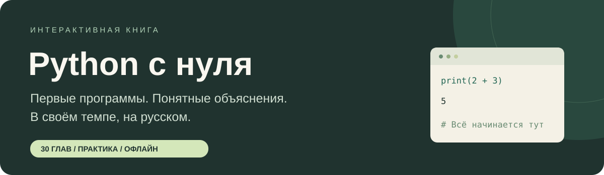

<p align="center">
  
</p>

<p align="center">
  <strong>Читай. Запускай. Меняй. Понимай.</strong><br>
  Учись программировать в своём темпе — прямо в настольной книге.
</p>

<p align="center">
  
  
  
  
</p>

<p align="center">
  <a href="#быстрый-старт">Быстрый старт</a> ·
  <a href="#что-внутри">Возможности</a> ·
  <a href="#маршрут-из-30-глав">Программа курса</a> ·
  <a href="#авторство-и-источник">Источник</a>
</p>

---

## Python с нуля

**`python-s-nulya` — интерактивная книга для тех, кто впервые открывает Python.** Читаешь объяснение, открываешь пример в редакторе, запускаешь его и решаешь небольшое задание. Всё в одной программе: уроки, код, подсказки и твои заметки.

**Проект переведён на русский язык и адаптирован для начинающих на основе курса [30 Days Of Python](https://github.com/Asabeneh/30-Days-Of-Python) от [Asabeneh Yetayeh](https://github.com/Asabeneh).** Термины объясняются по ходу, примеры можно менять, а ошибкам сопутствуют понятные подсказки.

> **Оригинальный проект:** [github.com/Asabeneh/30-Days-Of-Python](https://github.com/Asabeneh/30-Days-Of-Python). Эта версия содержит перевод с учебной адаптацией основных тем и собственное настольное приложение. Подробности об объёме адаптации — в разделе [«Авторство и источник»](#авторство-и-источник).

**30 глав — маршрут, а не дедлайн.** Можно заниматься по двадцать минут и возвращаться к сложным темам столько, сколько нужно.

## Что внутри

| | Что можно делать |
| :--- | :--- |
| 📖 **Читать** | 30 русских глав, оглавление, поиск по всему курсу и настройка размера текста |
| 🐍 **Писать код** | Редактор и запуск настоящего Python в отдельном процессе |
| 🧩 **Практиковаться** | 34 задания с проверкой вывода, подсказками и разборами решений |
| 💬 **Разбираться с ошибками** | Пояснения к частым исключениям и входные данные для `input()` |
| ✍️ **Делать заметки** | Личный блокнот к каждой главе и отдельные черновики заданий |
| 🌱 **Видеть прогресс** | Отметки пройденных глав, автосохранение и резервные копии |
| 🖨️ **Читать как книгу** | HTML для чтения и печати в PDF, а также единый Markdown-файл |

Для самого приложения **не нужны сторонние Python-библиотеки**. Основные уроки и задания работают без интернета. Установка pandas, Flask и других инструментов объясняется отдельно в соответствующих главах.

## Быстрый старт

1. Скачай проект через **Code → Download ZIP** на странице репозитория.
2. **Распакуй весь архив** в обычную папку.
3. Открой **[START-HERE.html](START-HERE.html)** — там пошаговая инструкция для твоей системы.
4. Установи **[Python 3.11 или новее](https://www.python.org/downloads/)** с компонентом Tkinter.
5. Запусти книгу способом из таблицы ниже.

| Система | Как запустить |
| :--- | :--- |
| **Windows** | Дважды щёлкни `START-Windows.bat` или выполни `py -3 app.py` |
| **macOS** | Открой терминал в папке проекта и выполни `python3 app.py` |
| **Linux** | Из папки проекта выполни `python3 app.py` или `sh start-linux.sh` |

> **Windows:** в установщике Python включи **Add python.exe to PATH** и оставь установленным компонент Tcl/Tk. Если команды `py` нет, попробуй `python app.py`.
>
> **Ubuntu / Debian:** если Tkinter отсутствует, установи его командой `sudo apt install python3-tk`.

Приложение рассчитано на компьютер с рабочим столом. В текущем комплекте нет готового EXE, подписанного приложения macOS или мобильной версии.

### Хочешь пока просто почитать?

После скачивания открой **`Книга.html`** в браузере — для чтения Python не нужен. Через кнопку печати можно сохранить книгу в PDF. Код в печатной версии не выполняется.

Исходный текст всей книги доступен в [Книга.md](Книга.md).

## Как заниматься

1. **Прочитай урок.** Разберись с одной идеей за раз.
2. **Запусти пример.** Зелёная ссылка над кодом перенесёт его в редактор.
3. **Измени что-нибудь.** Число, имя, условие — и сравни результат с ожиданием.
4. **Реши задание.** «Запустить» показывает результат, «Проверить вывод» сравнивает его с ожидаемым.
5. **Запиши своё объяснение.** Заметка своими словами помогает лучше, чем копирование готового решения.
6. **Отметь главу пройденной** и переходи дальше, когда почувствуешь уверенность.

Для `input()` заполняй поле входных данных заранее: **одно значение на строку**. Подсказки и готовые решения доступны, если застрял.

| Клавиши | Действие |
| :--- | :--- |
| `Ctrl + Enter` | Запустить код |
| `Ctrl + S` | Сохранить код, заметки и прогресс |
| `Tab` в редакторе | Вставить четыре пробела |

Проверка сравнивает **вывод программы**, а способ решения нужно сверять с условием. Отметка главы — твоя собственная оценка прохождения.

## Маршрут из 30 глав

| Шаг | Темы |
| :--- | :--- |
| **01–05 · Первые программы** | Введение, переменные, операторы, строки и списки |
| **06–10 · Данные и логика** | Кортежи, множества, словари, условия и циклы |
| **11–15 · Собираем код** | Функции, модули, генераторы списков, функции высшего порядка и ошибки |
| **16–20 · Практические инструменты** | Даты, исключения, регулярные выражения, файлы, JSON и pip |
| **21–25 · Более сложные задачи** | Классы, сбор данных со страниц, окружения, статистика, NumPy и pandas |
| **26–30 · Свой проект** | Веб, MongoDB, API, создание API и финальный список задач |

<details>
<summary><strong>Открыть все главы</strong></summary>

| № | Глава | № | Глава |
| :--- | :--- | :--- | :--- |
| 01 | [Первые шаги](course/01.md) | 16 | [Даты и время](course/16.md) |
| 02 | [Переменные и встроенные функции](course/02.md) | 17 | [Исключения](course/17.md) |
| 03 | [Операторы](course/03.md) | 18 | [Регулярные выражения](course/18.md) |
| 04 | [Строки](course/04.md) | 19 | [Файлы, JSON и CSV](course/19.md) |
| 05 | [Списки](course/05.md) | 20 | [Пакеты и pip](course/20.md) |
| 06 | [Кортежи](course/06.md) | 21 | [Классы и объекты](course/21.md) |
| 07 | [Множества](course/07.md) | 22 | [Сбор данных со страниц](course/22.md) |
| 08 | [Словари](course/08.md) | 23 | [Виртуальные окружения](course/23.md) |
| 09 | [Условия](course/09.md) | 24 | [Статистика и NumPy](course/24.md) |
| 10 | [Циклы](course/10.md) | 25 | [pandas](course/25.md) |
| 11 | [Функции](course/11.md) | 26 | [Python для веба](course/26.md) |
| 12 | [Модули](course/12.md) | 27 | [MongoDB](course/27.md) |
| 13 | [Генераторы списков и lambda](course/13.md) | 28 | [API](course/28.md) |
| 14 | [Функции высшего порядка](course/14.md) | 29 | [Создаём API](course/29.md) |
| 15 | [Ошибки Python](course/15.md) | 30 | [Финальный проект](course/30.md) |

</details>

## Прогресс остаётся у тебя

Код, заметки и отметки автоматически сохраняются на компьютере. Приложение не отправляет их на сервер.

**Перенос на другой компьютер:** выбери **Данные → Экспорт**, сохрани JSON, затем открой **Данные → Импорт** на другом компьютере. Файлы, созданные упражнениями в папке практики, перенеси отдельно.

<details>
<summary>Где находятся файлы прогресса</summary>

| Система | Папка |
| :--- | :--- |
| Windows | `%LOCALAPPDATA%\python-book-ru` |
| macOS | `~/Library/Application Support/python-book-ru` |
| Linux | `$XDG_DATA_HOME/python-book-ru` или `~/.local/share/python-book-ru` |

`progress.json` хранит черновики, заметки и отметки. В `practice/` остаются файлы упражнений. Эти папки можно открыть из меню **Данные**.

Перед импортом прежний прогресс сохраняется в `before-import.json`. Если основной файл повреждён, его исходное содержимое копируется в `progress-damaged.json`.

</details>

## Важно знать о запуске кода

Учебный код выполняется отдельным процессом с обычными правами пользователя и доступом к файлам компьютера. На запуск отведено **8 секунд**, до **64 КБ вывода** и **32 КБ входных данных**. Бесконечный цикл можно остановить кнопкой **Стоп**.

Долгие программы, графические окна и постоянные веб-серверы сохраняй через **Ещё → Сохранить код** и запускай отдельно. Примеры с внешними пакетами или серверами сопровождаются отдельными инструкциями в уроках.

## Структура проекта

```text
python-s-nulya/
├── app.py                 # Интерфейс книги
├── core.py                # Сохранение и выполнение кода
├── exercises.py           # Задания, подсказки и решения
├── course/                # 30 русских глав
├── original/              # Английские главы и версия источника
├── docs/                  # Оформление README
├── tests/                 # Автоматические проверки
├── START-HERE.html        # Инструкция первого запуска
├── START-Windows.bat      # Запуск в Windows
├── START-macOS.command    # Запуск в macOS
├── start-linux.sh         # Запуск в Linux
├── Книга.html             # Версия для чтения и печати
├── Книга.md               # Все главы одним текстом
└── build_release.py       # Сборка книги и ZIP-архива
```

## Разработка и проверка

Зависимостей сверх стандартной библиотеки для этих команд нет:

```bash
python -W error -m unittest discover -s tests -v
python build_release.py
```

На macOS/Linux при необходимости используй `python3`. Сборщик обновляет книгу и создаёт архив `../library-files/python-book-ru.zip`.

Тесты выполняют все решения заданий настоящим Python, проверяют кириллицу, `input()`, сообщения об ошибках, тайм-аут, остановку, ограничение вывода и восстановление прогресса.

Графический интерфейс пока не прошёл ручную проверку на Windows/macOS/Linux. Сетевые примеры, установка внешних пакетов и подключение к базам данных автоматически не проверялись.

## Авторство и источник

Исходный курс создан **[Asabeneh Yetayeh](https://github.com/Asabeneh)**: **[30 Days Of Python](https://github.com/Asabeneh/30-Days-Of-Python)**.

Эта книга — самостоятельное приложение с **переводом и учебной адаптацией всех 30 основных тем на русский язык**. Объяснения упрощены, добавлены задания и некоторые самостоятельные примеры. Полный построчный перевод каждого исходного упражнения, изображения и дополнительного материала в состав этой версии не входит.

Тексты основных английских глав сохранены в `original/`. Список файлов и Git tree SHA источника указаны в [original/SOURCE.json](original/SOURCE.json). Авторство исходного курса сохраняется; проект не является официальным выпуском автора. Новая лицензия на исходные материалы не назначается.

---

<p align="center"><strong>Начни с одной строки: <code>print("Привет, Python!")</code></strong><br>Дальше — по одной понятной программе за раз.</p>
